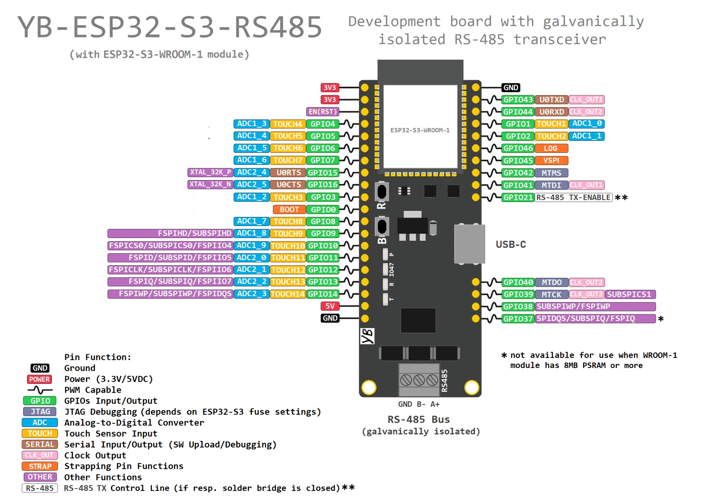
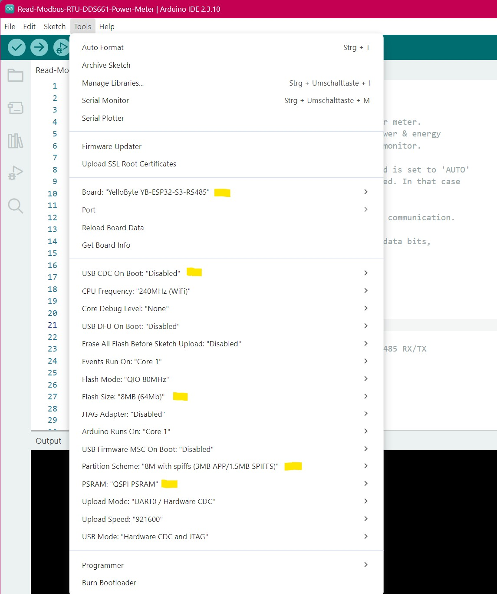
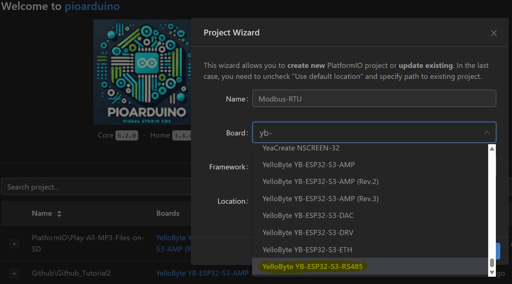
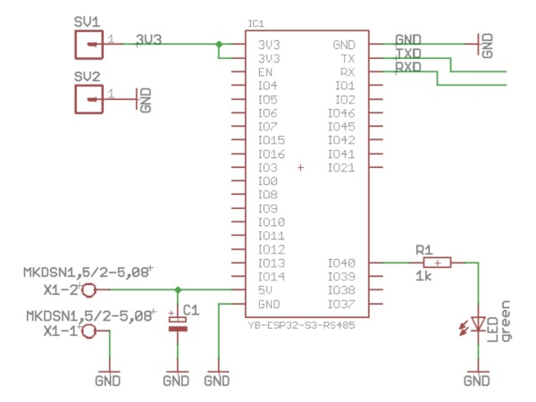
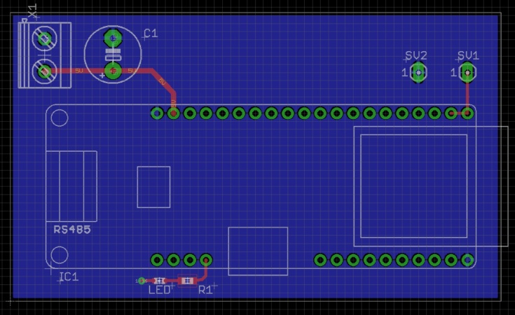

## YB-ESP32-S3-RS485 Development Board Overview:
The **YB-ESP32-S3-RS485** is a general purpose development board supporting **Modbus-RTU/ASCII** projects. It is based on Espressif's ESP32-S3 MCU and presently comes in two different variants:
- with **ESP32-S3-WROOM-1-N8R2 module** (8MB Flash/2MB PSRAM) or
- with **ESP32-S3-WROOM-1-N16R2 module** (16MB Flash/2MB PSRAM)

The 4-layer board provides a **RS-485 transceiver**, **CH334 USB-Hub** chip, **CH343 USB-UART** bridge chip, four **status LEDs** and a **USB-C connector** for software upload, serial output, JTAG debugging and feeding power to the board. The board is available on sales platforms [eBay](https://www.ebay.de/sch/i.html?_nkw=yb-esp32-s3) and [Ricardo.ch](https://www.ricardo.ch/en/s/YB-ESP32-S3).


The integrated RS-485 transceiver (bus driver) is **galvanically isolated** from the rest of the board which helps to improve stability and reliability in 'noisy' environments possibly affecting the RS-485 bus. However, 'galvanically isolated' does **not** mean you should forget common sense and deploy this board in a high voltage development project. You need to be a trained electrician/engineer to do that ! Always be aware, high voltages > ~60V can cause harm to living beings !

The built-in **RS-485 bus termination** (120Ω) if needed can be disabled by opening the 2 labeled solder bridges 'BUS-TERM' on the bottom of the board.

Arduino libraries for RS-485/Modbus-RTU are widely available (e.g. [**ModbusMaster**](https://github.com/4-20ma/ModbusMaster), [**modbus-esp**](https://github.com/emelianov/modbus-esp8266)), enabling you to easily realize ESP32 projects around this board with **Modbus-RTU/ASCII** support.

The densly populated YB-ESP32-S3-RS485 board provides multiple GPIO pins (as shown below) and is still [**highly breadboard compatible**](https://github.com/yellobyte/YB-ESP32-S3-RS485/raw/main/doc/YB-ESP32-S3-RS485_on_breadboard.jpg) for it leaves one row of accessible breadboard contacts on either side of the board. All I/O ports (GPIOx) are labeled on both sides of the board.

The onboard USB-Hub (USB high-speed HUB controller chip CH334) allows for simultaneous **JTAG debugging** and **serial output**. More info further down.

Software examples (for PlatformIO and/or ArduinoIDE) are available in folder [examples](https://github.com/yellobyte/YB-ESP32-S3-RS485/tree/main/examples). They will help you getting used to the board and explore all hardware features.

## Quickstart guide:
**All YB-ESP32-S3-RS485 boards delivered have already been flashed (and tested) with software example 'Read-Modbus-RTU-PT100-Sensor'.**
- Step 1) apply power (via USB or 5V pin)
- Step 2) watch the transmit LED 'T' blink when a Modbus request is sent  
If you happen to have a PT100 sensor module at hand pls connect it to the RS-485 bus, power it up and you will see the receive LED 'R' blink when the module replies.

## YB-ESP32-S3-RS485 board features:
 - **ESP32-S3-WROOM-1-NxR2** module (8 or 16MB Flash, 2MB PSRAM)
 - **WiFi PCB antenna** (on ESP32-S3-WROOM-1 module)
 - **RS-485 transceiver** (galvanically isolated from board) with integrated DC-DC converter (ultra small CA-IS2092A chip)
 - the **CA-IS2092A** pins required to control the chip are hardwired to the ESP32-S3 GPIOs as follows:
   - *RS485_TXD - GPIO17* (for transmitting data)
   - *RS485_RXD - GPIO18* (for receiving data)
   - *RS485_TX_ENABLE - GPIO21* (Only if solder bridge 'GPIO21' is closed. For MCU switching between receive [LOW] and transmit [HIGH]. If **solder bridge 'AUTO' is closed (default**) than switching between RS-485 bus receive/transmit is done automatically and GPIO21 is free for other use.)
 - **control LEDs**. The LED labeled 'P' is connected to the 3.3V rail to indicate board power and the LED labeled 'IO47' is connected to GPIO47 which can be used as status LED, for debugging purposes etc. LEDs labeled 'R'/'T' indicate received/transmitted data on the RS-485 bus.
 - **USB-C** port connected to the onboard CH334 USB-Hub chip. This allows for simultaneous JTAG debugging and serial output as well as software upload (e.g. via ArduinoIDE, VSCode/PlatformIO etc). The ESP32-S3 contains an inbuild JTAG adapter hence [**debugging**](https://github.com/yellobyte/ESP32-DevBoards-Getting-Started/tree/main/debugging) becomes fairly easy.
 - **hardware logic** for *automatic* software uploads (supported by most Development IDEs) via USB-C port using the onboard CH343 USB-UART bridge chip.
 - **pushbuttons**. One is labeled 'R' and resets the ESP32-S3 (shorts EN pin to ground) and the other one is labeled 'B' and shorts GPIO0 to ground when pressed. The latter is sometimes needed to force the board into boot mode.
 - **lots of available GPIOs** next to the ones already mentioned above.

The board will spare you the trouble of cabling different Arduino/extension boards and saves a lot of room on the breadboard as well:

 

## Board Pin Layout:
 

The boards **outline**, **schematic**, **pinout** and other files are all located in folder [doc](https://github.com/yellobyte/YB-ESP32-S3-RS485/tree/main/doc).

## Powering the board:
The board uses a LDO to drop the external supply voltage 5VDC to 3.3VDC. The RS-485 transceiver needs both voltages whereas the WROOM-1 module is only connected to the 3.3VDC rail. There are two different ways to provide power to the board:
  - through the USB-C port
  - 5VDC applied to the 5V pin

Normal operating current of the idle board (-N8R2, all GPIOs/RS-485 bus unconnected, WiFi disabled) is about 90mA. With RS-485 bus and WiFi active the board draws about 150...160mA (mainly depending on WiFi link).

## Application hints:
The board uses the popular WCH chips CH334P (USB-Hub) and CH343P (USB-UART bridge). If you haven't done yet then you need to install the CH343 Driver on your Laptop/PC. For Windows go [here](https://www.wch-ic.com/search?t=all&q=ch343) and download and install the newest version of the driver. Linux provides CH34x drivers by default.

### Arduino IDE:
As of Arduino ESP32 Core V4.0.0 you open the board list, enter "yb" and then select "**Yellobyte YB-ESP32-S3-RS485**". Now choose the proper settings for COM port, debug level, flash size, PSRAM, etc. as shown below. Be aware, since the ESP32-S3 MCU is very versatile there are a lot of build options to play with. Espressif's homepage offers some help.

Settings that apply to the standard board with **-N8R2** module (8MB Flash/2MB PSRAM):
- Board: *Yellobyte YB-ESP32-S3-RS485*
- Flash Size: *8MB (64Mb)*
- Partition Scheme: *8MB with spiffs (...)*
- PSRAM: *QSPI PSRAM*

 

For **-N16R2** module (16MB Flash/2MB PSRAM) the following settings apply:
- Board: *Yellobyte YB-ESP32-S3-RS485*
- Flash Size: *16MB (128Mb)*
- Partition Scheme: *16MB with spiffs (...)*
- PSRAM: *QSPI PSRAM*.

### PlatformIO:
Building with **PlatformIO** is easy as well. Starting with Arduino ESP32 Core v4.0.0 the VSCode/PlatformIO IDE provides the necessary board definition file. Such *.json files provide the correct board definitions & settings.

Just create a new project and give it a name, then go to board selection, enter "yb-" and choose the YB-ESP32-S3-RS485 board from the list.

 

**Important:**  
If the WROOM module features **16MB** flash memory, add the following lines to the *platformio.ini* project file's respective **[env]** section to account for the 16MB flash available. Otherwise you are restricted to 8MB (as set in the *.json board file).
```
...
board_build.partitions = default_16MB.csv
board_upload.flash_size = 16MB
board_upload.maximum_size = 16777216
...
```
### Using the USB-C port:
With the board connected to your PC/Laptop you'll see 3 additional USB devices. Two COM ports: **Serial USB device** and **USB-Enhanced-Serial CH343** and one device: **USB JTAG/serial debug unit** (or similar, depending on your OS).

You can connect a serial monitor program on your PC/Laptop to device "USB-Enhanced-Serial CH343" and watch the serial output generated with e.g. Serial.print(). Important: This serial connection is **not** affected by any board reset.

Device "USB JTAG/serial debug unit" lets you simultaneously debug the board via the ESP32-S3 integrated JTAG debug circuitry. How to use the latter for debugging is explained in detail [**here**](https://github.com/yellobyte/ESP32-DevBoards-Getting-Started/tree/main/debugging).

**Please note:** The PlatformIO builder scripts (*.json) for modules containing ESP32-S3/C3 normally define the build flag _ARDUINO_USB_MODE=1_. This enables the USB-Serial-JTAG controller and disables the USB-OTG-Controller in the ESP32-S3. If you want to override it you can (re-)define it in your platformio.ini control file. Normally you don't have to worry about it.

### Software Upload to the board:
Uploading new software to boards with your IDE is a breeze. Select the correct COM port and upload the program. The integrated hardware logic will put the board into upload mode automatically.

Below the PlatformIO log of flashing the dev board with provided software example [Read-Modbus-RTU-PT100-Sensor](https://github.com/yellobyte/YB-ESP32-S3-RS485/tree/main/examples/PlatformIO/Read-Modbus-RTU-PT100-Sensor). Please note: the example has been build with option `CORE_DEBUG_LEVEL=3` on PlatformIO (which is equivalent to `Core Debug Level: "Info"` on ArduinoIDE) and therefore produces only moderate output at startup.
```
Uploading .pio\build\release\firmware.bin
esptool v5.3.0
Serial port COM8:
Connecting....
Connected to ESP32-S3 on COM8:
Chip type:          ESP32-S3 (QFN56) (revision v0.2)
Features:           Wi-Fi, BT 5 (LE), Dual Core + LP Core, 240MHz, Embedded PSRAM 2MB (AP_3v3)
Crystal frequency:  40MHz
MAC:                18:8b:0e:cb:c7:1c

Uploading stub flasher...
Running stub flasher...
Stub flasher running.
Changing baud rate to 921600...
Changed.

Configuring flash size...
Auto-detected flash size: 8MB

Writing 'D:\Projects\VSCode\ESP32\YB-ESP32-S3-RS485\Test-Read-Modbus-RTU-PT100-Sensor\.pio\build\release\bootloader.bin' at 0x00000000...
SHA digest in image updated.
Flash will be erased from 0x00000000 to 0x00004fff...
Compressed 19968 bytes to 12993...
...
...
Wrote 19968 bytes (12993 compressed) at 0x00000000 in 0.4 seconds (410.8 kbit/s).
Verifying written data...
Hash of data verified.

Writing 'D:\Projects\VSCode\ESP32\YB-ESP32-S3-RS485\Test-Read-Modbus-RTU-PT100-Sensor\.pio\build\release\partitions.bin' at 0x00008000...
Flash will be erased from 0x00008000 to 0x00008fff...
Compressed 3072 bytes to 146...
...
...
Wrote 3072 bytes (146 compressed) at 0x00008000 in 0.0 seconds (556.0 kbit/s).
Verifying written data...
Hash of data verified.

Writing 'C:\Users\tj\.platformio\packages\framework-arduinoespressif32\tools\partitions\boot_app0.bin' at 0x0000e000...
Flash will be erased from 0x0000e000 to 0x0000ffff...
Compressed 8192 bytes to 47...
...
...
Wrote 8192 bytes (47 compressed) at 0x0000e000 in 0.1 seconds (668.0 kbit/s).
Verifying written data...
Hash of data verified.

Writing '.pio\build\release\firmware.bin' at 0x00010000...
Flash will be erased from 0x00010000 to 0x00056fff...
Compressed 289568 bytes to 165141...
...
...
Writing at 0x00056b20 [██████████████████████████████] 100.0% 165141/165141 bytes... 
Wrote 289568 bytes (165141 compressed) at 0x00010000 in 2.4 seconds (960.9 kbit/s).
Verifying written data...
Hash of data verified.

Hard resetting via RTS pin...
============================================================== [SUCCESS] Took 12.89 seconds ==============================================================
```
However, at any time and if needed you can force the ESP32-S3 into upload mode *manually*. Keep the **'B'** button pressed, then press/release the **'R'** button and finally release the **'B'** button. The serial monitor output will subsequently confirm the boards readiness for getting flashed.
```
....
23:19:07.453 > ESP-ROM:esp32s3-20210327
23:19:07.453 > Build:Mar 27 2021
23:19:07.453 > rst:0x1 (POWERON),boot:0x0 (DOWNLOAD(USB/UART0))
23:19:07.459 > waiting for download
```
## Integrating this board into your own PCB design projects:
Its easy. Folder [doc](https://github.com/yellobyte/YB-ESP32-S3-RS485/tree/main/doc) provides the Eagle library file **_yb-esp32-s3-rs485.lbr_** containing the board. Most other PCB design software (e.g. KiCad) are able to import and use Eagle lib files.

<p align="center">&nbsp;&nbsp;&nbsp;&nbsp;</p>

## Running MicroPython on the board:

Of course you can install MicroPython onto the YB-ESP32-S3-RS485 board and use it's WiFi, SPI, I2C, ADC, GPIO and other features via python scripts.

**Step 1)** Load MicroPython onto the board. Go to https://micropython.org/download/ESP32_GENERIC_S3/ and download the newest *.bin firmware release. Here you will find detailed installation instructions as well.

**Step 2)** Erase the entire flash on the board with
```
esptool.py erase_flash
```
If esptool.py can't determine which port your board is connected to, try
```
esptool.py --port PORTNAME erase_flash
```
**Step 3)** Flash the previously downloaded firmware to the board, e.g.
```
esptool.py --port COM4 --baud 460800 write_flash 0 ESP32_GENERIC_S3-20260406-v1.28.0.bin
```
**Step 4)** Reboot the board by shortly pressing the 'R' button. Then connect your serial monitor to the correct port (here COM4) and press ENTER. If flashing was successful you will be greeted with
```
01:57:53.819 > Build:Mar 27 2021
01:57:53.819 > rst:0x1 (POWERON),boot:0x8 (SPI_FAST_FLASH_BOOT)
01:57:53.825 > SPIWP:0xee
01:57:53.825 > mode:DIO, clock div:1
01:57:53.825 > load:0x3fce2820,len:0xeac
01:57:53.830 > load:0x403c8700,len:0xc28
01:57:53.830 > load:0x403cb700,len:0x2ff8
01:57:53.830 > entry 0x403c88ac
01:57:54.370 > MicroPython v1.28.0 on 2026-04-06; Generic ESP32S3 module with ESP32S3
01:57:54.375 > Type "help()" for more information.
01:57:54.375 > >>>
```
which confirms that MicroPython is now up and running on your board. Just enter *help()* and MicroPython will present some help info.

**Example 1: Switching the onboard status LED (GPIO47) on/off:**
```
>>> import machine <Enter>
>>> from machine import Pin <Enter>
>>> p0 = Pin(47, Pin.OUT) <Enter>
>>> p0.on() <Enter>
>>> p0.off() <Enter>
```

**Example 2: Scanning for WiFi-APs**
```
>>> import network <Enter>
>>> wlan = network.WLAN() <Enter>
>>> wlan.active(True)
True
>>> wlan.scan() <Enter>
```
It takes a few seconds and then MicroPython should present a list of found WiFi access points.

For more detailed info about MicroPython running on ESP32 please have a look here:
https://docs.micropython.org/en/latest/esp32/quickref.html

## General notes:

1) The ESP32-S3-WROOM-1 module family comprises several [**versions**](https://github.com/yellobyte/ESP32-DevBoards-Getting-Started/raw/main/ESP32_specs_and_manuals/ESP32-S3-WROOM-1(U)_Variants.jpg). The **-1** versions come with embedded PCB antenna, the **-1U** versions with IPEX antenna socket instead. The extension -Nx(Ry) defines the amount of integrated FLASH/PSRAM, e.g. -N4 (4MB Flash, no PSRAM), -N4R2 (4 MB Flash, 2MB PSRAM), -N8R2 (8 MB Flash, 2MB PSRAM) etc.  

2) The ESP32-S3 includes four SPI controllers: SPI0, SPI1, SPI2(Fast SPI) and SPI3. SPI0/1 are reserved for Flash and PSRAM (if available) and should be left alone!
The remaining two are available for the public. In the ESP32-S3's Arduino universe SPI2 & SPI3 are named FSPI & HSPI. FSPI by default is assigned to GPIOs 10-15 and routed via IO MUX. However, both can get pinned to any available GPIO pin if needed but FSPI will be slower if routed through GPIO Matrix

3) The board supports USB Serial JTAG debugging via ESP32-S3 integrated JTAG circuitry. Look [**here**](https://github.com/yellobyte/ESP32-DevBoards-Getting-Started/tree/main/debugging).
